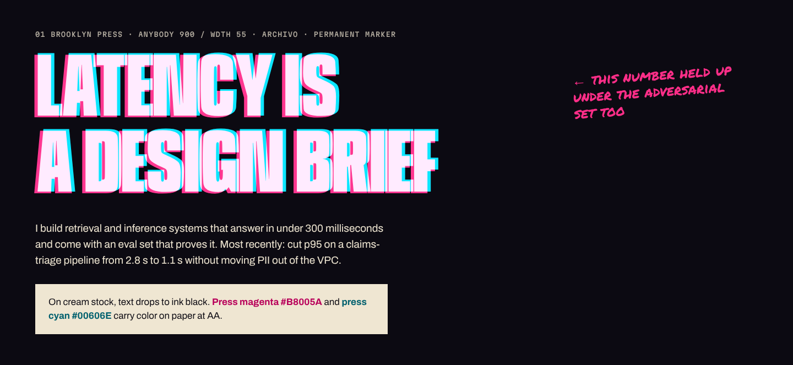
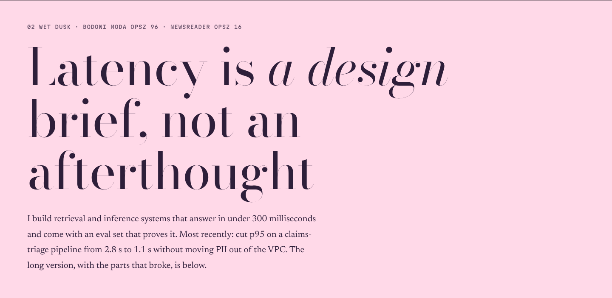
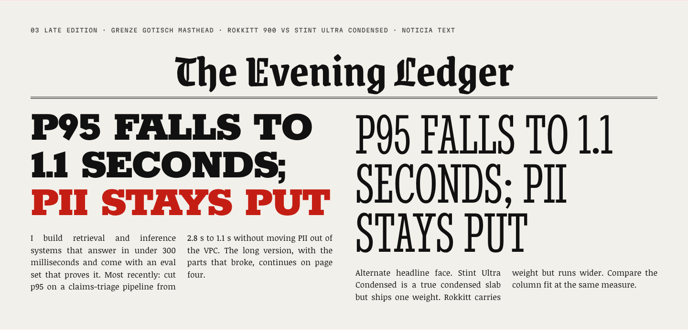
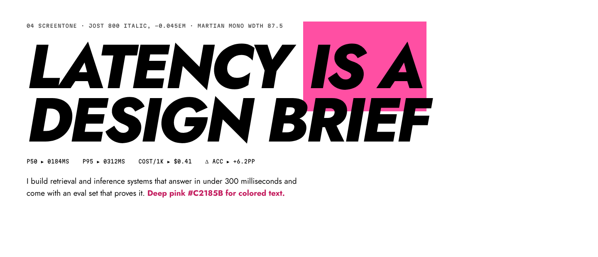

# DESIGN.md — STRANDS

Source of truth for every visual and motion decision on this site. Code mirrors this file:
`src/strands/tokens.ts` holds the same values, and `pnpm tokens:check` fails when the two drift.
If a component needs a value that is not here, add it here first.

---

## 0. The idea in one paragraph

The site exists as four printed realities. Each one is a complete art direction: its own paper,
inks, typefaces, grid, motion clock, cursor, sound and voice. A visitor can tear the page into a
different reality at any moment. The content and the information architecture never change, so
the switch reads as the same story printed by a different press, which is the point: the work holds
up no matter how it is dressed. Underneath all four sits **civilian mode**, the plain document the
strands are printed over.

---

## 1. Guardrails

### 1.1 IP: craft only

We borrow techniques that belong to print and animation history: halftone, Ben-Day dots,
misregistration, screentone, mixed frame rates, panel grammar, kinetic lettering. We do not borrow
anything that belongs to a franchise.

Never render, reference or approximate:

- any spider, web, web-like radial lattice (spokes **plus** concentric rings), or spider emblem
- masks, suits, or eye shapes resembling mask lenses (white teardrop or almond eyes on a dark face)
- any character, character name, studio or publisher name, logo, or film still
- any "Earth-" followed by a number, or any numbered-universe designation
- franchise phrases: *canon event*, *leap of faith*, *anyone can wear the mask*, *with great power*,
  *multiverse*, *spider-sense*, *go-home*, and the web-shooter sound *thwip*
- "anomaly" in visible copy (it is film vocabulary; STRAND-00 is an internal id only)

`pnpm slop-lint` greps built HTML, CSS and JS for these terms.

### 1.2 Anti-slop (instant fail, enforced by `pnpm slop-lint` where machine-checkable)

| Banned | Check |
| --- | --- |
| Purple/blue/indigo gradient hero | CSS scan for gradients with hue 230–290 in hero scope |
| Glassmorphism, 3-column card grids | `backdrop-filter` banned outside chrome; review |
| "Hi, I'm", waving hand, any emoji | regex `\p{Extended_Pictographic}`, phrase list |
| "Let's build something amazing together", "Passionate about", "cutting-edge", "in today's fast-paced world", "leverag(e/ing)" | phrase list |
| Inter, default Tailwind or shadcn look | font-family scan; Tailwind not installed |
| Particles or starfields | review |
| Typewriter hero | review |
| Skill bars with percentages | type system: skills are `string[]`, no numbers |
| Centered single column as default | layout review per page |
| Identical project cards | five cover archetypes, see §7 |
| Lorem ipsum | regex `lorem|ipsum|dolor sit` |
| "not just X, but Y", rhetorical triads, em-dash-stuffed sentences | copy review; regex for "not just .* but" |
| `ease`, `ease-in-out`, `ease-in`, `ease-out`, `transition: all` | `scripts/lint-easing.mjs` |

### 1.3 Accessibility floor (every strand, every mode)

- WCAG 2.2 AA contrast for all text: 4.5:1 body, 3:1 for text ≥ 24px or ≥ 18.66px bold.
- Focus indicators: at least 2px, at least 3:1 against both adjacent colors.
- No more than three flashes in any one second (WCAG 2.3.1). No full-viewport saturated red flash.
- Anything that moves automatically for more than five seconds can be paused (WCAG 2.2.2):
  the chrome's motion control ("hold still") stops it.
- Decorative layers are `aria-hidden="true"` and carry `data-deco`.
- Every strand keeps the same landmarks and heading order. Strands restyle; they never reorder.
- The visible nav label always contains the route word, so speech-input users can say it (2.5.3).

---

## 2. Global system

### 2.1 Modes and attributes on `<html>`

| Attribute | Values | Set by |
| --- | --- | --- |
| `data-strand` | `01` `02` `03` `04` (`00` is runtime-only) | `?strand=` → localStorage → `01` |
| `data-mode` | `strand` `civilian` | `?mode=` → localStorage → `strand` |
| `data-motion` | `full` `reduced` | site toggle → `prefers-reduced-motion` |
| `data-sound` | `on` `off` | site toggle; default `off` |
| `data-vt` | `strand` `nav` (during transitions) | engine |

### 2.2 CSS layer order

```
@layer reset, base, strand, components, state;
```

- **base** is civilian mode. It is designed as a document, not a fallback.
- **strand** rules live inside `@media screen { :root[data-mode="strand"][data-strand="NN"] … }`.
  Print and civilian mode therefore get base only, by construction.
- `[data-deco]` is `display: none` in base.

### 2.3 Breakpoints (art-directed, not just reflowed)

| Name | Range | Reference width | Reading model |
| --- | --- | --- | --- |
| `phone` | < 600px | 375 | Vertical webtoon: one panel per beat, full-bleed, thumb-zone chrome at the bottom |
| `tablet` | 600–1023px | 768 | Two-tier page: panels pair up, chrome splits top and bottom |
| `desk` | 1024–1919px | 1440 | Full spread: overlapping panels, margins carry annotations |
| `wall` | ≥ 1920px | 2560 | Broadsheet: extra columns, never a stretched desk layout; 03 adds columns, 02 adds air, 01 bleeds further, 04 widens the HUD frame |

### 2.4 Motion clock tiers

| Tier | Rate | Used for | Mechanism |
| --- | --- | --- | --- |
| `twos` | 12 fps | Display ink plates, SFX lettering, counters in 01, hero re-typeset | `clock.ts` commits only on 83.3 ms boundaries |
| `ones` | 24 fps | Film grain (03), speed lines (04) | `clock.ts` 41.7 ms boundaries, or CSS `steps()` |
| `smooth` | display rate | Parallax, ambient drift, washes, aberration spring | rAF or CSS scroll-driven animations |
| `immediate` | input rate | Cursor reticle, UI chrome, focus | direct style writes in the pointer handler |

Reduced motion: `twos`, `ones` and `smooth` subscribers never mount. Only opacity transitions
remain, each 240 ms with `--ease-fade` (`cubic-bezier(0.4, 0, 0.6, 1)`).

### 2.5 Shared transition timing (the tear)

| Phase | Window | What happens |
| --- | --- | --- |
| Charge | 0–180 ms | `--ab` 0 → 1 on `--ease-charge` `cubic-bezier(0.7, 0, 0.9, 0.4)`; target fonts load (race capped at 180 ms) |
| Tear | 180–720 ms | View transition; jagged clip sweeps on `--ease-tear` `cubic-bezier(0.76, 0, 0.24, 1)`; new strand's plates re-typeset on twos behind it |
| Settle | 720–880 ms | `--ab` 1 → 0 on the *target* strand's settle easing |

- Tear edge: a polyline of 28–40 points, jitter ±2.4vw, regenerated per switch from a seed.
  The edge carries a 10px paper-fiber fringe and two ink fringes in the target strand's colors.
- Direction: the tear travels away from the switcher (right-to-left from the desk rail,
  bottom-to-top from the phone strip).
- Interrupt: a new request jumps running animations to 6× playback (≤ 80 ms), then starts the next
  tear from the current frame. Requests collapse to the latest.
- Reduced motion: 240 ms opacity crossfade. No aberration, no tear.
- Announce: polite live region, e.g. "Strand 03, Late Edition."

---

## 3. STRAND-01 — BROOKLYN PRESS (default)



**Feel:** a riso zine pulled at 2am. Two spot inks that never quite line up, a dot screen you can
count, spray-can edges, marker notes in the margins. Aggressive, loud, slightly broken.

### Color

| Token | Hex | Role | Contrast |
| --- | --- | --- | --- |
| `--paper` | `#0C0A12` | Night stock, page ground | — |
| `--stock` | `#EFE6D2` | Dirty cream panel stock | — |
| `--ink-magenta` | `#FF2E88` | Spot ink 1, display on night | 5.62 on paper |
| `--ink-cyan` | `#00E5FF` | Spot ink 2, display on night | 12.79 on paper |
| `--text` | `#EFE6D2` | Body text on night | 15.85 on paper |
| `--text-dim` | `#A79C8C` | Secondary text on night | 7.28 on paper |
| `--ink-black` | `#0C0A12` | Body text on cream | 15.85 on stock |
| `--press-magenta` | `#B8005A` | Magenta for text on cream | 5.31 on stock |
| `--press-cyan` | `#00606E` | Cyan for text on cream | 5.84 on stock |
| `--stock-dim` | `#5E5548` | Secondary text on cream | 5.90 on stock |

Rules:
- On night stock, ink layers blend with `mix-blend-mode: screen` (inks read as light).
  On cream, they blend with `multiply` (real riso overprint: magenta × cyan → deep violet-blue).
- Electric cyan `#00E5FF` never sets text on cream (1.2:1).

### Type

| Role | Face | Settings |
| --- | --- | --- |
| Display | **Anybody** (variable) | `wght 900`, `wdth 55`, uppercase, `line-height .82`, `letter-spacing -.01em` |
| Text | **Archivo** (variable) | `wght 400/600`, `wdth 100`, `line-height 1.55` |
| Annotation | **Permanent Marker** | `line-height 1.15`, rotate −2° to −6° |

Scale (ratio 1.25 from 18px; then the jump):
`--fs-0 1.125rem · --fs-1 1.4rem · --fs-2 1.75rem · --fs-3 2.2rem · --fs-4 2.75rem ·
--fs-5 clamp(3.5rem, 9vw, 7rem) · --fs-6 clamp(4.5rem, 14vw, 13rem) · --fs-splash clamp(10rem, 40vw, 36rem)`

The width axis is a motion channel: SFX and hero plates animate `wdth 50 → 70 → 55` on twos.

### Texture

| Texture | Recipe |
| --- | --- |
| Ben-Day screen | `radial-gradient(circle, ink 0 var(--dot-r), transparent calc(var(--dot-r) + .4px)) 0 0 / 4px 4px`. Tone via `--dot-r` 0.6 / 1.0 / 1.4px; ramps via `mask-image: linear-gradient(...)`. |
| Misregistration | Heading = real text node + two `aria-hidden` plates (magenta, cyan) offset 2–4px, fixed per heading by seed. Plates spread further with `--ab`. |
| Overspray | Pre-rendered 512px PNG speckle tiles (alpha falloff) used as `mask-image` on panel edges; 3 variants, chosen by seed. |
| Paper fiber | 256px grayscale noise tile, 6% opacity, `screen` on night, `multiply` on cream. |
| Marker annotations | Real text in Permanent Marker; hand-drawn arrow/circle SVG strokes with 2px jitter. |

### Motion

| Token | Value | Use |
| --- | --- | --- |
| `--ease-squeegee` | `cubic-bezier(0.83, 0, 0.17, 1)` | Wipes, page slides |
| `--ease-plate-slam` | `cubic-bezier(0.7, 0, 0.84, 0)` | Plates landing (accelerate into impact) |
| `--ease-ink-kick` | `cubic-bezier(0.2, 1.4, 0.4, 1)` | SFX pop, small overshoot |
| `--ease-settle` | `cubic-bezier(0.3, 0.7, 0.2, 1)` | Tear settle into 01 |
| Durations | `--dur-snap 120ms · --dur-move 320ms · --dur-wipe 540ms` | |
| Clock | Display plates, SFX, counters on **twos**; paper fiber static; aberration spring smooth | |

Scroll aberration: the magenta and cyan plates separate horizontally by up to 14px (6px on phone)
with scroll velocity, then snap back on a stiff spring.

Hero resolve: plates start 18px out of register and drift into register as the hero scrolls
away. At perfect register a third plate (a marker annotation) prints in.

### Layout

- 12-column broken grid, `--gutter: 12px`, panel border 4px ink with overspray edges.
- Panels overlap by 1–3 columns; at least one element per section bleeds off-canvas by up to 8vw.
- Annotations live in margins on desk/wall; on phone they pin to the panel corner they reference.
- Spacing scale (8px base, ×1.25): `4 · 8 · 10 · 12 · 16 · 20 · 24 · 32 · 40 · 48 · 64 · 96`.

### Cursor (pointer: fine)

Misregistered reticle: two 22px rings (magenta, cyan) offset 2px that rotate apart with pointer
speed. Over links the rings snap into register. Click stamps a 3×3 Ben-Day dot cluster that fades
over 600ms (stepped on twos). Touch: tap prints a single ink dot burst at the touch point.

### Sound (opt-in)

Switch: bandpassed white-noise sweep (paper rip, 1.8 kHz → 600 Hz, 260ms) over a 70 Hz sine thunk.
UI tick: 40ms filtered noise click. Nav: short squeegee swish.

### Focus

Doubled outline: 3px `--ink-magenta` at offset 2px plus 3px `--ink-cyan` at offset 5px, shifted
1px diagonally. On cream panels the inks swap to press variants.

### Voice

Uppercase, blunt, street. Short.

| Key | Copy |
| --- | --- |
| Nav (home, work, about, lab, writing, contact) | COVER · ISSUES · ORIGIN · SCRAPS · ZINE · HOLLER |
| Switcher label | REPRINT AS |
| Civilian toggle | STRIP THE INK |
| Motion toggle | HOLD STILL |
| Sound toggle | TURN IT UP / KILL THE NOISE |
| 404 title | MISPRINT |
| 404 body | This page jammed in the drum. The plates came out blank. |
| Read case study | READ THE ISSUE |

### SFX lexicon (invented)

`SKRAANCH` (plate tear) · `FSSKT` (spray) · `VRAMPF` (drum) · `KLUNNT` (stamp) · `GRAZZT` (rip) ·
`BRAKKADUNG` (slam)

---

## 4. STRAND-02 — WET DUSK



**Feel:** the exhale. Wet-on-wet watercolor, pigment pooling at the edges of shapes, nothing with a
hard shadow. The background hue drifts on its own like the sky after sunset.

### Color

| Token | Hex | Role | Contrast |
| --- | --- | --- | --- |
| `--paper` | `#FBF6EF` | Warm paper white | — |
| `--wash-blush` | `#FFD9E8` | Wash | — |
| `--wash-teal` | `#9FE3DA` | Wash | — |
| `--wash-lavender` | `#D9CCF2` | Lavender haze wash | — |
| `--ink` | `#2E1F3A` | Text (deep plum) | 14.22 paper · 11.90 blush · 10.54 teal · 10.10 lavender |
| `--ink-soft` | `#5B4A68` | Secondary text | 7.44 paper · 6.23 blush · 5.52 teal · 5.29 lavender |
| `--ink-rose` | `#7A2F5E` | Accent text, links | 6.82 blush · 6.04 teal · 5.79 lavender |

Rules: pastels are washes only, never text. The drift animates hue between blush, lavender and
teal; the worst-case wash (lavender) still clears 5.29:1 for the softest text.

### Type

| Role | Face | Settings |
| --- | --- | --- |
| Display | **Bodoni Moda** (variable) | `opsz 96`, `wght 400`, italics for emphasis; only at ≥ 32px (hairlines) |
| Text | **Newsreader** (variable) | `opsz 16`, `wght 400`, `line-height 1.75`, measure 58–64ch |
| Accent | Bodoni Moda italic | pull quotes, captions |

Scale (ratio 1.333 from 19px): `1.1875rem · 1.58rem · 2.1rem · 2.8rem · 3.75rem ·
clamp(3.5rem, 7vw, 6.5rem) · splash clamp(8rem, 30vw, 26rem)`. Lowercase-leaning; never all caps.

### Texture

| Texture | Recipe |
| --- | --- |
| Watercolor field | WebGL2 fragment shader at ¼ resolution: domain-warped fbm, pigment granulation, darker edges where washes meet. Lazy chunk, only in 02. CSS fallback: three large pre-blurred radial gradients drifting on transforms. |
| Bleed edges | Panels have no border; edges use a soft mask (`mask-image` of a blurred blob PNG) so washes bloom past them. |
| Paper | Cold-press paper tile, 256px, `multiply` at 10%. |
| Hue drift | `--drift` cycles blush → lavender → teal over 48s. Paused by "hold still". |

### Motion

| Token | Value | Use |
| --- | --- | --- |
| `--ease-seep` | `cubic-bezier(0.32, 0, 0.15, 1)` | Ink seeping outward |
| `--ease-bloom` | `cubic-bezier(0.16, 1, 0.3, 1)` | Things opening, page transitions |
| `--ease-float` | `cubic-bezier(0.37, 0, 0.63, 1)` | Ambient drift |
| `--ease-settle` | `cubic-bezier(0.22, 0.8, 0.3, 1)` | Tear settle into 02 |
| Durations | `--dur-snap 240ms · --dur-move 700ms · --dur-wipe 1200ms` | |
| Clock | Everything **smooth**. No twos in this strand; it is the exhale. | |

Scroll aberration becomes pigment bleed: display type gets a soft blush/teal halo that spreads with
velocity (blurred plates, not hard offsets).

Hero resolve: the headline starts wet (blurred plates bleeding outward) and dries as the hero
scrolls away; edges sharpen, a pale wash pools beneath.

### Layout

- 6-column loose grid, `--gutter: 48px`, very tall section rhythm, single dominant element per view.
- Vertical flow; asymmetry comes from offsets (text column sits at columns 2–5, images drift right).
- Spacing scale (8px base, ×1.618): `8 · 13 · 21 · 34 · 55 · 89 · 144`.

### Cursor

A soft pigment drop (14px, blush, blurred edge). Over targets it blooms to 48px and tints teal.
Movement leaves a fading wash trail (Canvas2D at ½ res, 900ms fade). Touch: tap blooms a ring of
pigment that spreads and dries.

### Sound

Switch: two detuned sine "glass" tones (A5, E6) through a generated 2.4s convolution reverb.
UI: soft noise wash 120ms. Nav: low sine swell.

### Focus

Ink halo: `outline: 2px solid var(--ink)` plus a 6px `--wash-teal` blurred `box-shadow` behind it.
The outline alone carries the 3:1 requirement.

### Voice

Lowercase, quiet, a little poetic. Never cute.

| Key | Copy |
| --- | --- |
| Nav | first light · pieces · where i'm from · sketchbook · letters · write back |
| Switcher label | drift to |
| Civilian toggle | dry the page |
| Motion toggle | hold still |
| Sound toggle | let it ring / hush |
| 404 title | washed out |
| 404 body | this page was left in the rain. the paper is still here; the words ran off it. |
| Read case study | read slowly |

### SFX lexicon (invented)

`shhwaa` (wash) · `plihm` (drop) · `hwoom` (swell) · `tisss` (bleed) · `ooloo` (bloom)

---

## 5. STRAND-03 — LATE EDITION



**Feel:** a 1930s evening paper read under a desk lamp. Monochrome newsprint, heavy grain, light
through venetian blinds, hard shadows, tilted photographs. One spot color, used like a scream.

**Specimen decision:** Rokkitt (planned) is a wide geometric slab, not a condensed one; it read as a
wanted poster. **Stint Ultra Condensed** is a true condensed slab and sets a 1930s deck correctly,
so it replaces Rokkitt. It ships a single weight; headlines get weight from size and ink spread,
never faux bold.

### Color

| Token | Hex | Role | Contrast |
| --- | --- | --- | --- |
| `--paper` | `#EFEDE6` | Newsprint | — |
| `--ink` | `#111111` | Text, linework | 16.12 on paper |
| `--ink-grey` | `#5C5C5C` | Secondary text | 5.71 on paper |
| `--night` | `#111111` | Shadow panels | — |
| `--night-text` | `#EFEDE6` | Text on shadow | 16.12 |
| `--night-grey` | `#9A9A9A` | Secondary on shadow | 6.71 |
| `--spot` | `#C41E14` | Press red, **fewer than five uses per page** | 5.06 on paper · 3.19 on night (large only) |

Spot budget per page (enforced by e2e test): masthead rule, one headline word, one key number,
plus at most one more. Charts never use the spot; series use hatching.

### Type

| Role | Face | Settings |
| --- | --- | --- |
| Masthead | **Grenze Gotisch** (variable) | `wght 700`, centered, double rule beneath |
| Headline | **Stint Ultra Condensed** | uppercase, `line-height .9`, no tracking |
| Text | **Noticia Text** | 400/700, `line-height 1.5`; justified only in columns ≥ 34ch, ragged otherwise |

Scale (ratio 1.2 from 17px, then the jump): `1.0625rem · 1.275rem · 1.53rem · 1.84rem · 2.2rem ·
clamp(3rem, 8vw, 6.5rem) · splash clamp(9rem, 34vw, 30rem)`.

### Texture

| Texture | Recipe |
| --- | --- |
| Film grain | 8-frame 128px noise sprite, cycled with `steps(8)` at 24 fps (`ones`). Static in reduced motion. |
| Venetian blinds | `repeating-linear-gradient(-12deg, …)` hard-edged slats at 38% `multiply`, drifting slowly (smooth). |
| Halftone | Visible newsprint halftone: 6px cells at 45°, dot gain via slight blur + threshold. **Note:** literal 65 lpi at 96 CSS px/inch is a 1.5px cell, which reads as flat grey on screen. We reproduce what 65 lpi newsprint looks like under a loupe. |
| Chiaroscuro | Images: grayscale, crushed contrast (`contrast(1.6)`), hard vignette; built at image-pipeline time. |
| Dutch angles | Panels, photos, headlines rotate ±2° to ±6°. **Body text never rotates.** |

### Motion

| Token | Value | Use |
| --- | --- | --- |
| `--ease-cut` | `steps(1, jump-end)` | Hard cuts |
| `--ease-shutter` | `steps(4, jump-none)` | Shutter blades, page transitions |
| `--ease-ratchet` | `steps(6, end)` | Counters, ticks |
| `--ease-settle` | `steps(3, jump-none)` | Tear settle into 03 |
| Durations | `--dur-snap 80ms · --dur-move 240ms · --dur-wipe 320ms` | |
| Clock | Grain on **ones**; display on **twos**; blinds **smooth**. No eased curves anywhere. | |

Scroll aberration becomes gate weave: the page jitters vertically ±1–3px on twos with velocity, and
a grey 30% ghost of display type doubles beneath (double exposure). No color split.

Hero resolve: the blinds open. Slats rotate from closed to open as the hero scrolls, admitting light
across the headline.

### Layout

- Broadsheet columns: 2 (phone) · 4 (tablet) · 6 (desk) · 8 (wall), `--gutter: 16px`, 1px column rules.
- Hard frames (2px ink), tilted panels, heavy black shadow panels for chiaroscuro.
- Spacing scale (4px base, ×1.2): `4 · 6 · 8 · 12 · 16 · 20 · 24 · 32 · 48`.

### Cursor

Hard light. A 220px cone of light (sharp-edged ellipse, no blur) follows the pointer; inside it the
venetian slat shadows lighten and grain drops. Over links the cone narrows and brightens. Touch: a
flashbulb pop at the tap point (single 120ms pop, never repeated within 400ms).

### Sound

Switch: mechanical shutter (two 6ms noise transients 40ms apart with a 3.2 kHz metallic resonance).
Ambient: room hiss at −42 dB while sound is on. Nav: typewriter clack.

### Focus

Hard inversion box: element gets `background: var(--ink); color: var(--paper)` plus a 3px ink
outline at 3px offset. Never uses the spot color.

### Voice

Newsroom. Headline case, crisp, wry.

| Key | Copy |
| --- | --- |
| Nav | FRONT PAGE · CASE FILES · PROFILE · THE MORGUE · COLUMNS · TIPS LINE |
| Switcher label | CHANGE EDITION |
| Civilian toggle | PLAIN COPY |
| Motion toggle | STOP THE PRESSES |
| Sound toggle | ROOM TONE / SILENCE |
| 404 title | CORRECTION |
| 404 body | An earlier edition directed readers to this page. It does not exist. The editors regret the error. |
| Read case study | READ THE FULL STORY |

### SFX lexicon (invented)

`KLAK-TCHK` (shutter) · `THRUNN` (press) · `SKIK` (pen) · `TCHAKK` (slam) · `FWUPP` (paper)

---

## 6. STRAND-04 — SCREENTONE



**Feel:** a mecha manga printed on cheap white stock and pinned to a CRT. Speed lines, focus
bursts, dot screentone, scanlines, HUD readouts with ticks. Fast in, overshoot, snap.

### Color

| Token | Hex | Role | Contrast |
| --- | --- | --- | --- |
| `--paper` | `#FFFFFF` | Paper | — |
| `--line` | `#000000` | Linework and text | 21.00 |
| `--hot-pink` | `#FF4FA3` | Fills, large display only | 3.04 on paper; black text on it 6.90 |
| `--cyan` | `#00E1FF` | Screentone fill only on white | 1.59 on paper (never text on white) |
| `--pink-text` | `#C2185B` | Colored text on white | 5.87 |
| `--hud` | `#0A0A0A` | HUD panels | — |
| `--hud-cyan` | `#00E1FF` | HUD text | 12.46 on hud |
| `--hud-pink` | `#FF4FA3` | HUD alerts | 6.50 on hud |
| `--line-dim` | `#5A5A5A` | Secondary text | 6.90 on paper |

### Type

| Role | Face | Settings |
| --- | --- | --- |
| Display | **Jost** (variable) | `wght 800`, italic, uppercase, `letter-spacing -.045em`, `line-height .86` |
| Text | Jost | `wght 400/600`, `line-height 1.55` |
| HUD | **Martian Mono** (variable) | `wdth 87.5`, `wght 500`, uppercase, `letter-spacing .02em`, tabular |

Scale (ratio 1.333 from 18px): `1.125rem · 1.5rem · 2rem · 2.66rem · 3.55rem ·
clamp(4rem, 11vw, 10rem) · splash clamp(10rem, 42vw, 38rem)`.

### Texture

| Texture | Recipe |
| --- | --- |
| Dot screentone | `radial-gradient` 3px pitch at 45° (rotated container), tones 20/40/60% via dot radius |
| Speed lines | `repeating-conic-gradient` from a focus point with irregular stop widths. **Spokes only, never concentric rings.** |
| Focus burst | Jagged star polygon (SVG), 18–26 points, behind key numbers |
| CRT scanlines | `repeating-linear-gradient(0deg, rgb(0 0 0 / .08) 0 1px, transparent 1px 3px)`, fixed overlay |
| HUD frame | SVG corner brackets, edge rulers with ticks every 8px (major every 64px), live readouts (scroll %, strand id, time) |

### Motion

| Token | Value | Use |
| --- | --- | --- |
| `--ease-smash` | `cubic-bezier(0.05, 0.9, 0.1, 1)` | Fast in |
| `--ease-overshoot-snap` | `linear(0, 0.42 8%, 0.92 17%, 1.14 25%, 1.06 33%, 0.985 42%, 1.004 55%, 1)` | Overshoot then snap settle |
| `--ease-lock` | `cubic-bezier(0.9, 0, 0.1, 1)` | HUD lock-on |
| `--ease-settle` | same as `--ease-overshoot-snap` | Tear settle into 04 |
| Durations | `--dur-snap 90ms · --dur-move 260ms · --dur-wipe 380ms` | |
| Clock | Speed lines on **ones**; HUD readouts tick at 15 fps; display on **twos** for SFX only | |

Scroll aberration is a CRT channel split: pink and cyan copies of display type separate vertically
by up to 10px with velocity, plus scanline jitter.

Hero resolve: the HUD locks on. Corner brackets converge on the headline as the hero scrolls and a
readout prints `LOCK`.

### Layout

- 8pt hard grid, 12 columns, `--gutter: 16px`, HUD frame inset 24px (12px on phone).
- Panels are hard black rectangles with 3px line borders, cut diagonally at one corner.
- Spacing scale (8px base, ×1.333): `8 · 12 · 16 · 24 · 32 · 40 · 56 · 72 · 96`.

### Cursor

HUD crosshair with a 4-tick ring and live `X/Y` readout in Martian Mono. Fast movement leaves speed
lines along the motion vector (Canvas2D, `ones`, 250ms decay). Over targets the brackets snap
around the target's bounding box. Touch: a target-lock bracket snaps to the tapped element.

### Sound

Switch: rising square-wave sweep (220 → 1760 Hz, 180ms) into a noise burst. UI: 30ms square blip at
1.2 kHz. Nav: servo whirr (sawtooth with LFO, 200ms).

### Focus

HUD brackets: four 10px corner marks (3px, `--line`) snap from 8px outside to 3px outside the
element using `--ease-overshoot-snap`, plus a 2px solid outline for the 3:1 guarantee.

### Voice

Mission log. Uppercase, clipped, numeric.

| Key | Copy |
| --- | --- |
| Nav | BRIDGE · SORTIES · PILOT FILE · HANGAR · LOGS · OPEN CHANNEL |
| Switcher label | SWITCH FEED |
| Civilian toggle | HUD OFF |
| Motion toggle | FREEZE FRAME |
| Sound toggle | AUDIO ON / AUDIO OFF |
| 404 title | SIGNAL LOST |
| 404 body | NO TARGET AT THIS ADDRESS. LAST KNOWN POSITION LOGGED. RETURN TO BRIDGE. |
| Read case study | OPEN SORTIE REPORT |

### SFX lexicon (invented)

`ZZAKT` (lock) · `VREEEN` (charge) · `SHUNKT` (impact) · `GZZING` (burst) · `TRRRK` (servo)

---

## 7. Shared components: how they change per strand

| Component | 01 Brooklyn Press | 02 Wet Dusk | 03 Late Edition | 04 Screentone |
| --- | --- | --- | --- | --- |
| Chrome strip | Printer's color bar with registration marks | Swatch strip of washes | Newspaper folio line (date, edition, price) | HUD status bar with ticks |
| Panels | Thick ink borders, overspray edges, overlaps | No borders, bleeding edges | Hard frames, tilted, black shadow panels | Black line, cut corner |
| Issue covers (5 archetypes: splash, panel grid, giant number, diagram, type-only) | Riso zine covers | Watercolor book covers | Front pages and extras | Model-kit / tankōbon-style covers with HUD |
| Architecture diagram | Rough marker strokes, misregistered | Wash nodes, soft arrows | Hard ink, engraved hatching | HUD nodes, tick-marked edges |
| Eval spread | Riso splash, giant misregistered delta | Bloom bars | Sports-page box score, hatched series | HUD readouts and gauges |
| Counters | Twos, plate-stepped | Smooth fade-count | Ratchet steps | Overshoot snap |
| Page transition | Panel gutter slide (`--ease-squeegee`) | Bloom through soft masks (`--ease-bloom`) | Shutter snap (`--ease-shutter`) | Speed-line smash zoom (`--ease-overshoot-snap`) |

Every page has one unexpected moment; they are listed in the build plan and recorded per page in
`src/pages/*` header comments.

---

## 8. STRAND-00 (internal)

Not in any UI. Unlocks via Konami code (↑ ↑ ↓ ↓ ← → ← → B A) or five strand switches within three
seconds. Not URL-addressable, not persisted.

- Datamosh: Canvas2D macroblock smear (16px blocks sampled from strand palettes) in the motion
  direction, composited with `difference`; CSS slice displacement of sections (`clip-path` bands
  translated on twos).
- Two strands at once: display type renders top half in one strand's face, bottom half in another's.
- RGB channel separation follows the cursor vector.
- Readout: "MISREGISTRATION INDEX" counter climbs while active.
- Achievement toast (once): **"PLATE ZERO. You knocked the press out of register. Esc steadies it."**
- Dismiss: Esc, or the readout's "steady" button. Returns to the previous strand.
- Safety: no luminance flash above WCAG 2.3.1 thresholds; full-screen effects stay below 3 Hz.
- Reduced motion: a static misregistered frame with the readout. No animation.

SFX lexicon: corrupted splices of the four lexicons, generated (`SKR/ZZ/AKT`, `pl//HM`).

---

## 9. Civilian mode (the base layer)

A deliberate document design for a hiring manager on a locked-down laptop at 11pm.

| Token | Value |
| --- | --- |
| Font | `system-ui, -apple-system, "Segoe UI", Roboto, "Helvetica Neue", Arial, sans-serif` |
| Mono | `ui-monospace, "SF Mono", Menlo, Consolas, monospace` |
| Ground / text | `#FFFFFF` / `#111111` (18.88:1) |
| Secondary | `#4A4A4A` (8.86:1) |
| Link | `#0B4FD8` underlined (6.72:1) |
| Measure | 68ch, single column, left-aligned |
| Scale | 1rem · 1.25rem · 1.5rem · 2rem |
| Focus | 3px solid `#0B4FD8`, offset 2px |
| Motion | none |

- No textures, no WebGL, no custom cursor, no sound.
- Same document in print. Print adds URL expansion after links and page breaks before major sections.
- Résumé PDF (built from `content/profile.ts`) linked at the top.
- Toggle label in civilian mode: **"Back to the strands"**.

---

## 10. Fonts: delivery

| Strand | Families | Approx. latin woff2 |
| --- | --- | --- |
| 01 | Anybody (wght+wdth), Archivo (wght), Permanent Marker | ~57 + 30 + 25 KB |
| 02 | Bodoni Moda (opsz+wght), Newsreader (opsz+wght) | ~60 + 70 KB |
| 03 | Grenze Gotisch, Stint Ultra Condensed, Noticia Text 400/700 | ~25 + 15 + 40 KB |
| 04 | Jost (wght, roman+italic), Martian Mono (wght+wdth) | ~45 + 40 KB |

- All OFL 1.1 except Permanent Marker (Apache 2.0). Licenses ship in `public/fonts/LICENSES.md`.
- Self-hosted, subset to Basic Latin + Latin-1 punctuation by `scripts/subset-fonts.mjs`.
- `@font-face` rules are global, but browsers download a face only when rendered text uses it, and
  families are assigned only under `[data-strand]`. Only the active strand pays.
- The first-paint display face is preloaded; fallbacks get `size-adjust` and ascent/descent
  overrides to prevent layout shift.
- Hovering, focusing or touching a switcher item prefetches that strand's faces.
